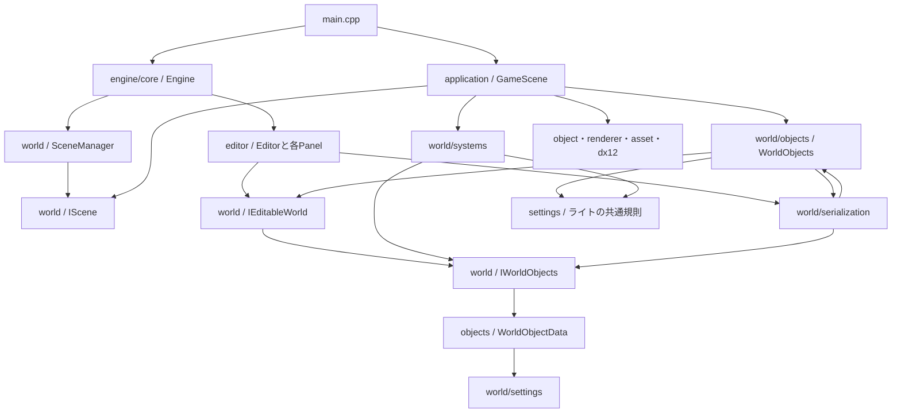

# 現在の依存関係

`engine/world`の分類、共有データ・共通操作・Editor操作の分離、ライトの相互依存解消と、タブ単位のPanel配置・クラスごとの.h/.cpp統合を反映した調査。調査対象は`project/CG2`の自作C++ソースとヘッダー143ファイルで、解決できた直接のローカルincludeは重複を除いて315組。外部ライブラリとテストはこの件数に含めない。

includeは条件付きコンパイルの両方の分岐を含めて数えている。ファイル単位のinclude循環は検出していない。ただし、フォルダを単位にすると相互依存がある。include循環がないことと、機能が独立していることは別である。

## 全体の関係

矢印は「参照・呼び出しを行う側 → 参照される側」。図は主要な経路を示し、全includeを列挙したものではない。

- `main.cpp`が`GameScene`を生成し、`Engine`へ渡す。
- `Engine`が実行ループを進め、`SceneManager`が`IScene`を通じて更新・描画する。`SceneManager::Finalize`が現在のシーンを破棄する。
- `GameScene`は`IScene`と`WorldObjects`を継承する。編集データは`WorldObjects`、描画中のObject・Particle・プレビューと物理などの実行状態は`GameScene`側が保持する。
- `Editor`は`IEditableWorld`を通じて編集する。`editor`から`application/GameScene.h`への直接includeはない。`world`から`editor`・`application`への直接includeもない。
- `Engine.h`は`USE_IMGUI`時に`Editor.h`をincludeし、`Editor`を値メンバーとして持つ。ReleaseでEditorを含めない分岐はあるが、共通のEngineクラスにEditorの起動・更新の接続がある。
- `ui/ImGuiSystem.cpp`も`editor/EditorTheme.h`を参照してEditorの配色を適用する。Engine側からEditor側への直接includeは、この箇所と`Engine.h`の2組ある。
- これらは同じCG2実行ファイルのソースとしてビルドされる。フォルダごとの独立したライブラリ境界はまだない。

## coreと各基盤機能の境界

従来のbaseは共有型・ログ・Win32を含み、coreもEngine・計測・ImGuiを含んでいた。役割ごとに移動し、baseという分類は廃止した。

| フォルダ | 担当 | 現在のファイル |
| --- | --- | --- |
| `core` | 各機能を生成・初期化し、実行ループと終了順を組み立てる | Engine.h / Engine.cpp |
| `types` | 状態を所有しない共有データ型・ID・enum・定数 | EngineStructs.h / LightStructs.h / LightLimits.h / WorldObjectTypes.h |
| `platform` | Windowsのウィンドウとメッセージ処理 | WinApp.h / WinApp.cpp |
| `diagnostics` | ログ出力とフレーム負荷の記録 | LogSystem.h / LogSystem.cpp / FrameProfiler.h |
| `ui` | ImGuiの初期化・フレーム開始終了・GPU送信の接続 | ImGuiSystem.h / ImGuiSystem.cpp |

Engineは組み立て役なので、各機能とEditorを参照する。typesには実行ループ・画面・ログ・シーン管理を置かず、現在の参照先は共有のmathだけである。uiはEditorのパネル処理を実装せず、現在はEditorThemeを使った配色の適用だけを参照する。platformのWin32メッセージ処理にはImGui入力の受け渡しがあり、diagnosticsのログ出力にはWindows APIが残る。フォルダの分類と、OS依存をなくす作業は別として扱う。

world/settingsには保存・編集する設定値と検証・比較を置く。Entityへ付け外しするComponentの実装とは区別し、実際の更新処理はsystemsへ置く。

## Editorのタブ単位の境界

panelsはhierarchy・inspector・project・console・scene_view・game_view・particle_editor・performanceに分類した。各タブのヘッダーとcppを同じフォルダへ集め、includeはその場所を明記する。全タブのフォルダをinclude検索先へ追加することはしない。各クラスは同名の.h/.cpp一組へまとめ、宣言だけで完結する補助は.hのみとする。

Editorは選択・履歴・表示要求を所有し、InspectorPanel::DrawSelectionが借用した選択から単体／複数Inspectorへ接続する。PerformancePanelは履歴の選択やCSV出力の表示状態を所有し、Editorは開閉状態だけを渡す。SceneViewPanelは共有のタブ切替・画像寸法と編集操作の状態を維持し、SceneViewPanel.cppとGameViewPanel.cppが各タブの内容を描く。GameViewPanelは状態を重複所有せず、選択・ギズモ・編集カメラ入力を扱わない。

## worldの内部

| 参照元 | 参照先 | 用途 |
| --- | --- | --- |
| `IEditableWorld.h` | `IWorldObjects.h` | 共通操作を継承し、Editor用の操作を追加 |
| `IWorldObjects.h` | `objects/WorldObjectData.h` | 一覧・親子関係・Transform・作成・置換の共通操作 |
| `objects/WorldObjectData.h` | `settings` | 保存・履歴・実行で共有する値と借用ビュー |
| `objects/WorldObjects.h` | `IEditableWorld` | オブジェクト一覧の実装 |
| `objects/WorldPrimitives.h` | `IWorldObjects` | 基本形状の作成 |
| `objects/WorldObjects.cpp` | `serialization/PrefabFile.h` | Prefabをシーンへ配置 |
| `serialization` | `objects` | 読込結果の検証・Prefabの構築 |
| `objects`・`systems`・ライト編集UI | `settings/LightSettings.h` | ライト種別・名前・設定検証・個数上限 |
| `settings/LightSettings.h` | `types/WorldObjectTypes.h`・`types/LightLimits.h` | 実装に依存しない種類・ID・配列上限 |
| `serialization/SceneFile.cpp` | `serialization/LegacyLightMigration.h` | 旧シーンへ固定ライト相当を追加 |
| `serialization/LegacyLightMigration.cpp` | `objects/WorldObjects.h` | 移行結果の全件検証 |
| `systems`・`serialization` | `IWorldObjects` | Transform・Componentの参照・更新と保存・復元 |
| `systems/WorldLighting.h` | `types/LightStructs.h` | 描画へ渡す固定長ライト配列 |
| `settings/ParticleSettings.h` | `dx12/BlendMode.h` | 合成方法のenum |

残る主な相互依存はPrefab配置・検証による`objects ↔ serialization`。ライトの種別・上限は共通規則へ、旧形式移行は保存処理側へ移し、`objects ↔ systems`は解消した。systemsから具体的なWorldObjectsへの参照も、serializationからsystemsへの参照もなくなった。

ライトの共通規則は標準ヘッダーとbaseの共有定義だけを参照し、WorldObjectData・WorldObjects・IWorldObjectsを必要としない。GPU配列とCPU側の上限検証は同じLightLimitsを使用する。ファイル単位のinclude件数は共通定義への明示的な参照によって増えているが、機能間の相互依存は減っている。

## 結合が強い箇所

### データ定義と共通操作は分離済み

`WorldObjectData`・`EditableObjectView`などのデータ型を`objects/WorldObjectData.h`へ移し、共通のオブジェクト操作を`IWorldObjects.h`へ分離した。実行処理・保存処理は`IWorldObjects`を受け取り、`IEditableWorld`固有のカメラ入力・補助画面・プレビュー操作を必要としない。

`IEditableWorld.h`への直接includeは16個から10個へ減った。ただし、`WorldObjectData`に全Componentの設定値を持たせる構造は維持している。また、`WorldObjects`は既存Editorとの接続を維持し、ライト移行などからこの具体実装を使う経路も残る。全ComponentやEditorへの間接的なinclude依存を解消したわけではない。

### 基礎データとAssetの型の置き場所

`asset/ModelAnimation.h`は、クリップ情報の`ModelAnimationInfo`を使うために`world/settings/AssetSettings.h`を参照する。同じファイルにはシーンに保存するMaterial・Animationの設定値もあり、Assetの読込情報とシーンの設定がまとまっている。

`ParticleSettings`が参照する`dx12/BlendMode.h`はenumのみで、DirectXのGPUリソース型を直接持ち込んではいない。ただし、共通設定の型がDirectX実装のフォルダにあるため、依存方向が読み取りにくい。

### GameSceneに実行処理が集中

`GameScene`はモデル・Particleの更新、ライト収集、物理・衝突、カメラ、モデルプレビュー、Asset準備とWorld SettingsのImGui表示をまとめている。起動時の組み立て役としての依存は自然だが、ゲーム個別の処理と再利用する実行機能の境目が薄い。

### Editorと描画基盤の接続

モデルのプレビューは`IEditableWorld`経由だが、`ProjectPanel.cpp`の画像プレビューは`TextureManager`を直接使用し、GPUハンドルを取得する。プレビューの取得経路は統一されていない。

`Engine`から`Editor`への参照は、現在の実行ループを組み立てるための接続でもある。すぐに誤りとは言えないが、Engineを独立したランタイムとして再利用する場合は、Editorを外側の起動処理へ接続する境界が必要になる。

## 整理する場合の優先順位

| 順番 | 作業 | 目的 |
| --- | --- | --- |
| 完了 | WorldObjectDataとIWorldObjectsをIEditableWorldから分離 | 実行・保存処理がEditor専用APIを要求する範囲を減らした |
| 完了 | ライトの種別・上限・検証と旧形式移行を分ける | objectsとsystemsの相互依存を解消し、保存からsystemsへの参照も取り除いた |
| 3 | Prefab配置の呼出境界を整理する | objectsとserializationの相互依存を解く。モデル準備や失敗時の原子性は維持する |
| 4 | Assetの読込情報とシーン設定を分け、BlendModeの配置を整理する | 共通の型を使う方向を明確にする |
| 5 | 必要な機能ごとに編集窓口を分け、GameSceneの共通実行処理を抽出する | 一つの型へ機能を追加し続ける構造を抑える |

窓口をメソッドごとに細分化したり、全処理をManager化したりする必要はない。まず共通データと検証の配置を整え、既存のScene保存・Undo/Redo・Prefab・再生停止時の復元をテストしながら依存を減らす。

フォルダ移動・include・Visual Studioのフィルター更新、共有データと共通インターフェースの分離、ライト処理の相互依存解消を実施した。次の対象はPrefab処理の相互依存であり、EnTTや実行時Reflectionの導入はまだ行っていない。
