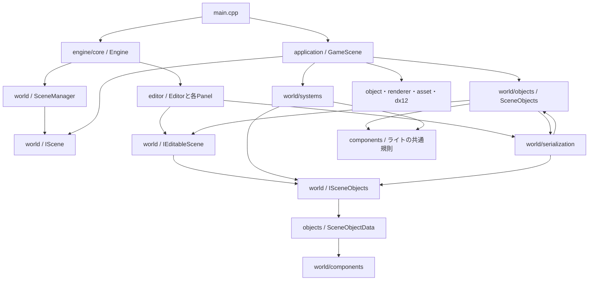

# 現在の依存関係

`engine/world`の分類、共有データ・共通操作・Editor操作の分離と、ライトの相互依存解消を反映した調査。調査対象は`project/CG2`の自作C++ソースとヘッダー153ファイルで、解決できた直接のローカルincludeは重複を除いて338組。外部ライブラリとテストはこの件数に含めない。

includeは条件付きコンパイルの両方の分岐を含めて数えている。ファイル単位のinclude循環は検出していない。ただし、フォルダを単位にすると相互依存がある。include循環がないことと、機能が独立していることは別である。

## 全体の関係

矢印は「参照・呼び出しを行う側 → 参照される側」。図は主要な経路を示し、全includeを列挙したものではない。

- `main.cpp`が`GameScene`を生成し、`Engine`へ渡す。
- `Engine`が実行ループを進め、`SceneManager`が`IScene`を通じて更新・描画する。`SceneManager::Finalize`が現在のシーンを破棄する。
- `GameScene`は`IScene`と`SceneObjects`を継承する。編集データは`SceneObjects`、描画中のObject・Particle・プレビューと物理などの実行状態は`GameScene`側が保持する。
- `Editor`は`IEditableScene`を通じて編集する。`editor`から`application/GameScene.h`への直接includeはない。`world`から`editor`・`application`への直接includeもない。
- `Engine.h`は`USE_IMGUI`時に`Editor.h`をincludeし、`Editor`を値メンバーとして持つ。ReleaseでEditorを含めない分岐はあるが、共通のEngineクラスにEditorの起動・更新の接続がある。
- `core/ImGuiSystem.cpp`も`editor/EditorTheme.h`を参照してEditorの配色を適用する。Engine側からEditor側への直接includeは、この箇所と`Engine.h`の2組ある。
- これらは同じCG2実行ファイルのソースとしてビルドされる。フォルダごとの独立したライブラリ境界はまだない。

## worldの内部

| 参照元 | 参照先 | 用途 |
| --- | --- | --- |
| `IEditableScene.h` | `ISceneObjects.h` | 共通操作を継承し、Editor用の操作を追加 |
| `ISceneObjects.h` | `objects/SceneObjectData.h` | 一覧・親子関係・Transform・作成・置換の共通操作 |
| `objects/SceneObjectData.h` | `components` | 保存・履歴・実行で共有する値と借用ビュー |
| `objects/SceneObjects.h` | `IEditableScene` | オブジェクト一覧の実装 |
| `objects/ScenePrimitives.h` | `ISceneObjects` | 基本形状の作成 |
| `objects/SceneObjects.cpp` | `serialization/PrefabFile.h` | Prefabをシーンへ配置 |
| `serialization` | `objects` | 読込結果の検証・Prefabの構築 |
| `objects`・`systems`・ライト編集UI | `components/SceneLightSettings.h` | ライト種別・名前・設定検証・個数上限 |
| `components/SceneLightSettings.h` | `base/SceneObjectTypes.h`・`base/LightLimits.h` | 実装に依存しない種類・ID・配列上限 |
| `serialization/SceneFile.cpp` | `serialization/SceneLightMigration.h` | 旧シーンへ固定ライト相当を追加 |
| `serialization/SceneLightMigration.cpp` | `objects/SceneObjects.h` | 移行結果の全件検証 |
| `systems`・`serialization` | `ISceneObjects` | Transform・Componentの参照・更新と保存・復元 |
| `systems/SceneLighting.h` | `base/LightStructs.h` | 描画へ渡す固定長ライト配列 |
| `components/ParticleSettings.h` | `dx12/BlendMode.h` | 合成方法のenum |

残る主な相互依存はPrefab配置・検証による`objects ↔ serialization`。ライトの種別・上限は共通規則へ、旧形式移行は保存処理側へ移し、`objects ↔ systems`は解消した。systemsから具体的なSceneObjectsへの参照も、serializationからsystemsへの参照もなくなった。

ライトの共通規則は標準ヘッダーとbaseの共有定義だけを参照し、SceneObjectData・SceneObjects・ISceneObjectsを必要としない。GPU配列とCPU側の上限検証は同じLightLimitsを使用する。ファイル単位のinclude件数は共通定義への明示的な参照によって増えているが、機能間の相互依存は減っている。

## 結合が強い箇所

### データ定義と共通操作は分離済み

`SceneObjectData`・`EditableObjectView`などのデータ型を`objects/SceneObjectData.h`へ移し、共通のオブジェクト操作を`ISceneObjects.h`へ分離した。実行処理・保存処理は`ISceneObjects`を受け取り、`IEditableScene`固有のカメラ入力・補助画面・プレビュー操作を必要としない。

`IEditableScene.h`への直接includeは16個から10個へ減った。ただし、`SceneObjectData`に全Componentの設定値を持たせる構造は維持している。また、`SceneObjects`は既存Editorとの接続を維持し、ライト移行などからこの具体実装を使う経路も残る。全ComponentやEditorへの間接的なinclude依存を解消したわけではない。

### 基礎データとAssetの型の置き場所

`asset/ModelAnimation.h`は、クリップ情報の`ModelAnimationInfo`を使うために`world/components/SceneAssetSettings.h`を参照する。同じファイルにはシーンに保存するMaterial・Animationの設定値もあり、Assetの読込情報とシーンの設定がまとまっている。

`ParticleSettings`が参照する`dx12/BlendMode.h`はenumのみで、DirectXのGPUリソース型を直接持ち込んではいない。ただし、共通設定の型がDirectX実装のフォルダにあるため、依存方向が読み取りにくい。

### GameSceneに実行処理が集中

`GameScene`はモデル・Particleの更新、ライト収集、物理・衝突、カメラ、モデルプレビュー、Asset準備とWorld SettingsのImGui表示をまとめている。起動時の組み立て役としての依存は自然だが、ゲーム個別の処理と再利用する実行機能の境目が薄い。

### Editorと描画基盤の接続

モデルのプレビューは`IEditableScene`経由だが、`ProjectAssets.cpp`の画像プレビューは`TextureManager`を直接使用し、GPUハンドルを取得する。プレビューの取得経路は統一されていない。

`Engine`から`Editor`への参照は、現在の実行ループを組み立てるための接続でもある。すぐに誤りとは言えないが、Engineを独立したランタイムとして再利用する場合は、Editorを外側の起動処理へ接続する境界が必要になる。

## 整理する場合の優先順位

| 順番 | 作業 | 目的 |
| --- | --- | --- |
| 完了 | SceneObjectDataとISceneObjectsをIEditableSceneから分離 | 実行・保存処理がEditor専用APIを要求する範囲を減らした |
| 完了 | ライトの種別・上限・検証と旧形式移行を分ける | objectsとsystemsの相互依存を解消し、保存からsystemsへの参照も取り除いた |
| 3 | Prefab配置の呼出境界を整理する | objectsとserializationの相互依存を解く。モデル準備や失敗時の原子性は維持する |
| 4 | Assetの読込情報とシーン設定を分け、BlendModeの配置を整理する | 共通の型を使う方向を明確にする |
| 5 | 必要な機能ごとに編集窓口を分け、GameSceneの共通実行処理を抽出する | 一つの型へ機能を追加し続ける構造を抑える |

窓口をメソッドごとに細分化したり、全処理をManager化したりする必要はない。まず共通データと検証の配置を整え、既存のScene保存・Undo/Redo・Prefab・再生停止時の復元をテストしながら依存を減らす。

フォルダ移動・include・Visual Studioのフィルター更新、共有データと共通インターフェースの分離、ライト処理の相互依存解消を実施した。次の対象はPrefab処理の相互依存であり、EnTTや実行時Reflectionの導入はまだ行っていない。
