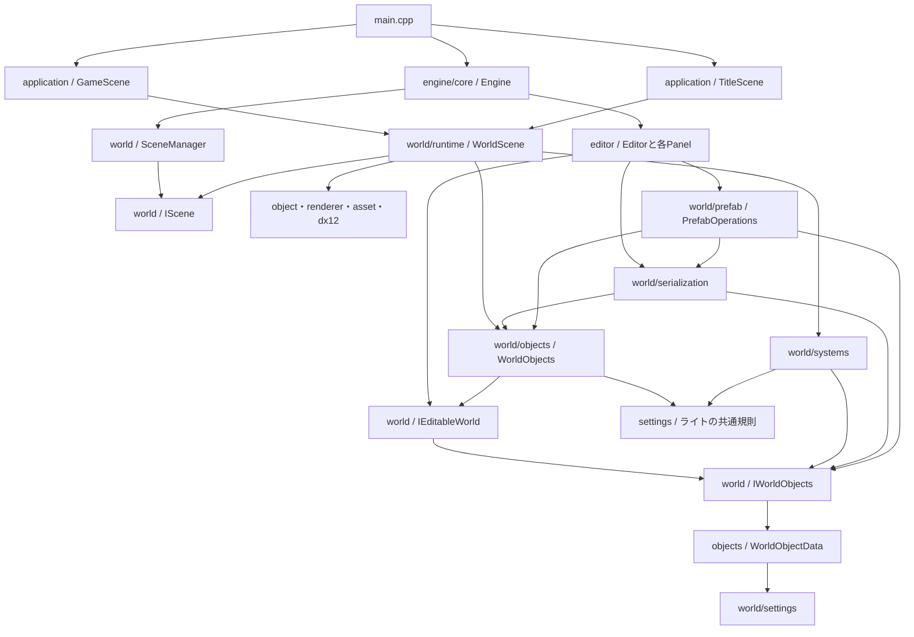

# 現在の依存関係

`engine/world`の分類、共有データ・共通操作・Editor操作の分離、ライトとPrefabの相互依存解消を反映した調査。調査対象は`project/CG2`の自作C++ソースとヘッダー178ファイルで、解決できた直接のローカルincludeは重複を除いて391組。外部ライブラリとテストはこの件数に含めない。

includeは条件付きコンパイルの両方の分岐を含めて数えている。ファイル単位のinclude循環は検出していない。ただし、フォルダを単位にすると相互依存がある。include循環がないことと、機能が独立していることは別である。

## 全体の関係

矢印は「参照・呼び出しを行う側 → 参照される側」。図は主要な経路を示し、全includeを列挙したものではない。

- `main.cpp`が`GameScene`を生成し、`Engine`へ渡す。`--title`指定時は`TitleScene`から開始する。
- `Engine`が実行ループを進め、`SceneManager`が`IScene`を通じて更新・描画する。遷移はPostDrawのGPU完了後に適用する。SceneManagerが現在・遷移待ち・再生開始時の編集シーンを所有し、終了時も解放する。
- `WorldScene`は`IScene`と`WorldObjects`を継承する。編集データは`WorldObjects`、描画中のObject・Particle・プレビューと物理などの実行状態は`WorldScene`側が保持する。GameSceneとTitleSceneはこの基底を使い、初期配置と場面遷移を定義する。
- `Editor`は`IEditableWorld`を通じて編集する。`editor`から`application/GameScene.h`への直接includeはない。`world`から`editor`・`application`への直接includeもない。
- `Engine.h`は`USE_IMGUI`時に`Editor.h`をincludeし、`Editor`を値メンバーとして持つ。ReleaseでEditorを含めない分岐はあるが、共通のEngineクラスにEditorの起動・更新の接続がある。
- EngineはImGuiの初期化後に`Editor::InitializeUi`を呼ぶ。Editor側でドッキング・配置ファイル・テーマを設定し、Engine側からEditor側への直接includeは`Engine.h`の1組になる。
- これらは同じCG2実行ファイルのソースとしてビルドされる。フォルダごとの独立したライブラリ境界はまだない。

## coreと各基盤機能の境界

従来のbaseは共有型・ログ・Win32を含み、coreもEngine・計測・ImGuiを含んでいた。役割ごとに移動し、baseという分類は廃止した。

| フォルダ | 担当 | 現在のファイル |
| --- | --- | --- |
| `core` | 各機能を生成・初期化し、実行ループと終了順を組み立てる | Engine.h / Engine.cpp |
| `types` | 状態を所有しない共有データ型・ID・enum・定数 | EngineStructs.h / LightStructs.h / LightLimits.h / WorldObjectTypes.h |
| `platform` | Windowsのウィンドウとメッセージ処理 | WinApp.h / WinApp.cpp |
| `diagnostics` | ログ出力とフレーム負荷の記録 | LogSystem.h / LogSystem.cpp / FrameProfiler.h / FrameProfiler.cpp |
| `ui` | ImGuiの初期化・フレーム開始終了・GPU送信の接続 | ImGuiSystem.h / ImGuiSystem.cpp |

Engineは組み立て役なので、各機能とEditorを参照する。typesには実行ループ・画面・ログ・シーン管理を置かず、現在の参照先は共有のmathだけである。uiはImGuiのコンテキストとWin32・DX12との接続を管理する。Editorのテーマと配置はeditor側が担当する。platformのWin32メッセージ処理にはImGui入力の受け渡しがあり、diagnosticsのログ出力にはWindows APIが残る。フォルダの分類と、OS依存をなくす作業は別として扱う。

world/settingsには保存・編集する設定値と検証・比較を置く。Entityへ付け外しするComponentの実装とは区別し、実際の更新処理はsystemsへ置く。

## Editorのフォルダと責務

`editor/core`はEditor本体、`editor/state`は選択と履歴、`editor/ui`はレイアウト・配色・共通の入力欄を担当する。パネル間で運ぶドラッグ情報は`editor/assets`の`AssetDragPayload`に置く。`core/Editor`が状態とパネルをつなぐ。

panelsはhierarchy・inspector・project・console・scene_view・game_view・particle_editor・performanceに分類した。各タブのヘッダーとcppを同じフォルダへ集め、includeはその場所を明記する。全タブのフォルダをinclude検索先へ追加することはしない。各クラスは同名の.h/.cpp一組へまとめ、宣言だけで完結する補助は.hのみとする。

Editorは選択・履歴・表示要求を所有し、InspectorPanel::DrawSelectionが借用した選択から単体／複数Inspectorへ接続する。PerformancePanelは履歴の選択やCSV出力の表示状態を所有し、Editorは開閉状態だけを渡す。SceneViewPanelは共有のタブ切替・画像寸法と編集操作の状態を維持し、SceneViewPanel.cppとGameViewPanel.cppが各タブの内容を描く。GameViewPanelは状態を重複所有せず、選択・ギズモ・編集カメラ入力を扱わない。

## worldの内部

| 参照元 | 参照先 | 用途 |
| --- | --- | --- |
| `IEditableWorld.h` | `IWorldObjects.h` | 共通操作を継承し、Editor用の操作を追加 |
| `IWorldObjects.h` | `objects/WorldObjectData.h` | 一覧・親子関係・Transform・作成・置換の共通操作 |
| `objects/WorldObjectData.h` | `settings` | 保存・履歴・実行で共有する値と借用ビュー |
| `objects/WorldObjects.h` | `IEditableWorld` | オブジェクト一覧の実装 |
| `objects/WorldPrimitives.h` | `IWorldObjects` | 基本形状の作成 |
| `prefab/PrefabOperations.cpp` | `objects/WorldObjects.h`・`serialization/SceneFile.h` | Prefab操作の組立・仮データの検証・ファイル読書きの委譲 |
| `serialization` | `objects` | 読込結果の検証・旧形式の移行 |
| `objects`・`systems`・ライト編集UI | `settings/LightSettings.h` | ライト種別・名前・設定検証・個数上限 |
| `settings/LightSettings.h` | `types/WorldObjectTypes.h`・`types/LightLimits.h` | 実装に依存しない種類・ID・配列上限 |
| `serialization/SceneFile.cpp` | `serialization/LegacyLightMigration.h` | 旧シーンへ固定ライト相当を追加 |
| `serialization/LegacyLightMigration.cpp` | `objects/WorldObjects.h` | 移行結果の全件検証 |
| `systems`・`serialization` | `IWorldObjects` | Transform・Componentの参照・更新と保存・復元 |
| `systems/WorldLighting.h` | `types/LightStructs.h` | 描画へ渡す固定長ライト配列 |
| `settings/ParticleSettings.h` | `types/BlendMode.h` | 合成方法のenum |

Prefab操作を`prefab/PrefabOperations`へ移し、`objects ↔ serialization`を解消した。`objects`はPrefab操作や保存処理を参照せず、`serialization`もPrefab操作を参照しない。ライトの種別・上限は共通規則へ、旧形式移行は保存処理側へ移し、`objects ↔ systems`も解消している。systemsから具体的なWorldObjectsへの参照も、serializationからsystemsへの参照もない。

### Prefabを追う順番

以前は`Editor → WorldObjects::PlacePrefab → PrefabFile → WorldObjects`という経路だった。現在は`Editor → PrefabOperations::Place → SceneFile::Load`で読み込み、一時的な`WorldObjects`でID・親子関係・配置位置を検証する。最後に、受け取った`IWorldObjects`の`ReplaceObjects`へ全件を渡す。

最終反映は仮想関数の呼出を維持する。実際の配置先が`WorldScene`なら、モデルなどのGPU準備も成功してから置き換える。準備や検証に失敗した場合は、既存の配置と次のIDを変更しない。Undo／Redoは従来どおり反映後の配置を記録する。

`WorldObjects`を読むときはデータ一覧とTransform操作、`PrefabOperations`を読むときは保存・配置・Apply／Revertの手順、`SceneFile`を読むときは保存形式と読書きに集中できる。新しいインターフェースやManagerは追加せず、既存の共通操作を利用している。Scene13形式と`.ponprefab`の内容は変更していない。

ライトの共通規則は標準ヘッダーとtypesの共有定義だけを参照し、WorldObjectData・WorldObjects・IWorldObjectsを必要としない。GPU配列とCPU側の上限検証は同じLightLimitsを使用する。ファイル単位のinclude件数は共通定義への明示的な参照によって増えているが、機能間の相互依存は減っている。

## 結合が強い箇所

### データ定義と共通操作は分離済み

`WorldObjectData`・`EditableObjectView`などのデータ型を`objects/WorldObjectData.h`へ移し、共通のオブジェクト操作を`IWorldObjects.h`へ分離した。実行処理・保存処理は`IWorldObjects`を受け取り、`IEditableWorld`固有のカメラ入力・補助画面・プレビュー操作を必要としない。

`IEditableWorld.h`への直接includeは現在14個ある。ただし、`WorldObjectData`に全Componentの設定値を持たせる構造は維持している。また、`WorldObjects`は既存Editorとの接続を維持し、ライト移行などからこの具体実装を使う経路も残る。全ComponentやEditorへの間接的なinclude依存を解消したわけではない。

### 基礎データとAssetの型の置き場所

`types/ModelImportInfo.h`はモデルから読み取ったマテリアルの既定値とアニメーションクリップ情報を定義する。モデルの読込側と`IEditableWorld`が同じ型を参照する。`world/settings/AssetSettings.h`はオブジェクトごとのマテリアル上書きとアニメーション再生設定を定義し、`Object3d.cpp`が実際の描画と再生に適用する。

`types/BlendMode.h`は合成方法を定義する。`ParticleSettings`と`PipelineManager`が同じ型を参照し、実際のDirectX用ブレンド設定は`PipelineManager`で組み立てる。

### 共通の場面基底とゲーム固有処理を分離

モデル・Particleの更新、ライト収集、物理・衝突、カメラ、Asset準備は`world/runtime/WorldScene`が担当する。GameSceneは保存読込・初期配置・サンプルSpriteのHUD、TitleSceneはタイトル専用の配置を担当する。共通基底からapplicationやEditorへの参照は追加していない。

WorldSceneは描画・プレビュー・シミュレーションの呼出順を調整する。プレビュー描画はModelPreviewRendererへ、動作・物理・衝突はWorldMotion、WorldPhysics、WorldCollisionへ委譲する。

### Editorと描画基盤の接続

`ProjectPanel`はモデルと画像の両方を`editor/assets/AssetThumbnailCache`へ依頼する。キャッシュは準備を1フレーム1件に抑え、モデルなら`IEditableWorld`、画像なら`TextureManager`から描画用ハンドルを借りる。パネルは返された寸法を使って縦横比を保ったまま描く。

`WorldScene::GetModelPreview`は必要なモデルを検証・読込し、`renderer/ModelPreviewRenderer`へ渡す。Rendererは専用カメラと描画先を持ち、画像を一度描いてキャッシュする。Asset移動ではキーだけを替え、シーンを破棄するときはGPUの完了後に描画先を解放する。

`Engine`から`Editor`への参照は、現在の実行ループを組み立てるための接続でもある。すぐに誤りとは言えないが、Engineを独立したランタイムとして再利用する場合は、Editorを外側の起動処理へ接続する境界が必要になる。

## 整理する場合の優先順位

| 順番 | 作業 | 目的 |
| --- | --- | --- |
| 完了 | WorldObjectDataとIWorldObjectsをIEditableWorldから分離 | 実行・保存処理がEditor専用APIを要求する範囲を減らした |
| 完了 | ライトの種別・上限・検証と旧形式移行を分ける | objectsとsystemsの相互依存を解消し、保存からsystemsへの参照も取り除いた |
| 完了 | Prefab操作をPrefabOperationsへ移す | objectsとserializationの相互依存を解消。モデル準備や失敗時の原子性を維持する |
| 完了 | BlendModeをtypesへ移す | パーティクル設定とDirectX描画処理が共通の型を参照する |
| 完了 | Assetの読込情報とシーン設定を分ける | モデル読込側からワールドの設定への参照を外す |
| 完了 | 3Dサムネイル描画をModelPreviewRendererへ移す | WorldSceneから専用カメラ・描画先・キャッシュ管理を分離する |

窓口をメソッドごとに細分化したり、全処理をManager化したりする必要はない。まず共通データと検証の配置を整え、既存のScene保存・Undo/Redo・Prefab・再生停止時の復元をテストしながら依存を減らす。

フォルダ移動・include・Visual Studioのフィルター更新、共有型と共通インターフェースの分離、ライト・Prefab処理の相互依存解消を実施した。

## Projectのファイル操作

ProjectPanelはeditor/assets/AssetActionDialogへ操作を委譲し、AssetFileOperationsがファイル操作、AssetDocumentが各形式の参照を担当する。これらは一つのクラスを複数cppへ分けたものではなく、各責務を同名の.h/.cppにまとめた独立したクラスである。

engine/asset/AssetPathChangeはパスの変換と使用箇所の文字列だけを持ち、ModelManagerなどのGPU型やWorld型を参照しない。world/objects/WorldAssetReferencesがWorldObjectDataの参照を列挙・更新する。WorldObjectsからassetへの新しい参照は、このパス値だけを使うためのものになる。

実行側への通知はIEditableWorld::RemapAssetPathsで行い、WorldSceneが既存GPUキャッシュを更新する。EditorSessionとParticleEditorPanelはそれぞれ自分が所有する保存基準を更新する。Asset操作サービスからEditor本体やWorldSceneの具体型を参照する経路は作っていない。ファイル単位のinclude循環は引き続き検出していない。

## 複数Scene Assetの編集

`editor/scene/SceneDocument`が現在の配置ファイルを所有し、保存・検証・読込を`world/serialization/SceneFile`へ委譲する。`SceneAssetDialog`は選択結果を返し、Editorが未保存確認と履歴・選択の初期化を行う。ProjectPanelは開く要求とAsset改名通知を返すだけで、SceneDocumentやEditor本体を参照しない。

起動時の保存先はIScene→SceneManager→Engine経由のメタデータとして一度だけ渡し、編集中の保存先をゲーム側へ逆参照させない。配置切替後の一時状態の解除はIEditableWorld::OnSceneContentsChangedを使う。WorldからEditorへのincludeは追加していない。
